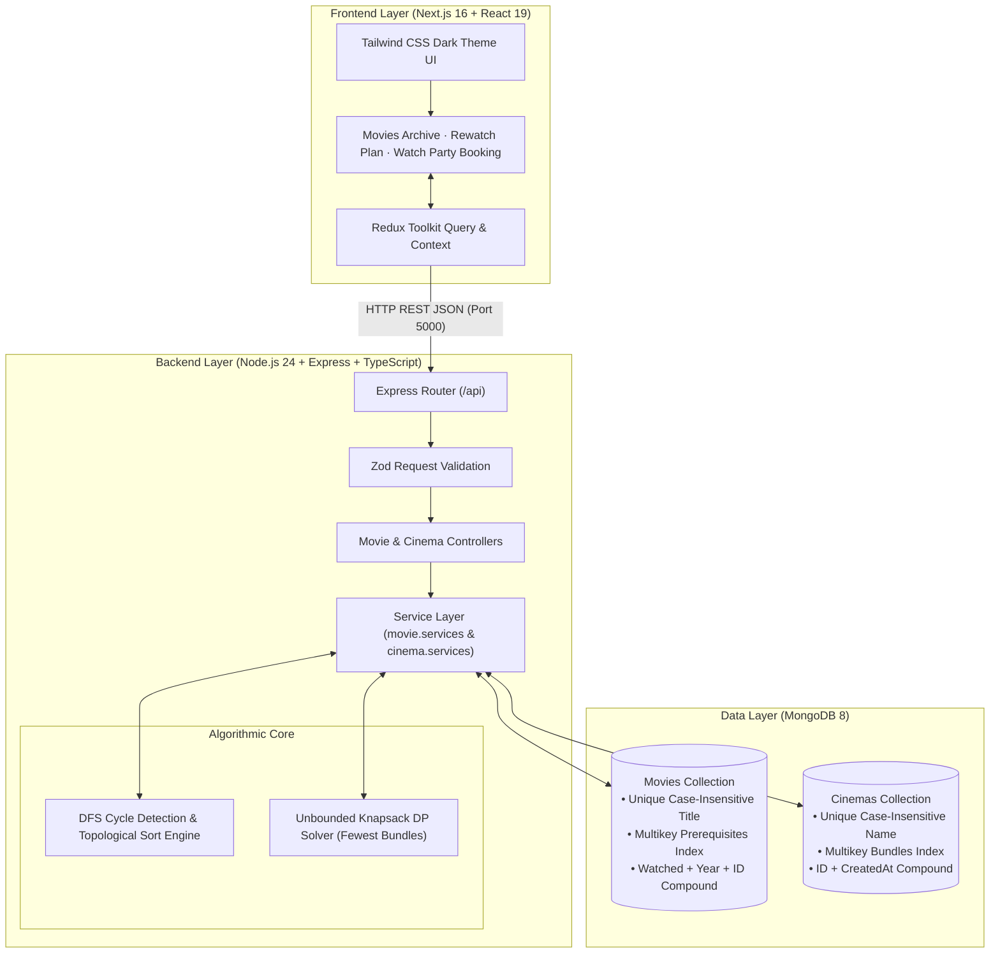
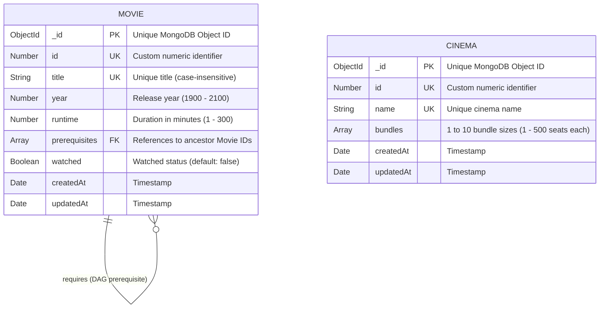

# 🎬 Doomsday Ready — Full-Stack MCU Rewatch & Watch-Party Planner

[](https://www.typescriptlang.org/)
[](https://nextjs.org/)
[](https://expressjs.com/)
[](https://www.mongodb.com/)
[](https://www.docker.com/)
[](https://doomsday-ready-frontend.vercel.app)

**Doomsday Ready** is a full-stack web application designed for MCU fans catching up before _Avengers: Doomsday_. It helps viewers determine the exact prerequisites and sequence to watch films in, tracks watched status, and solves cinema group bundle allocations for opening-night watch parties.

> 🌐 **Live Frontend Application**: [https://doomsday-ready-frontend.vercel.app](https://doomsday-ready-frontend.vercel.app)  
> ⚡ **Live Backend API**: [https://doomsday-ready-backend.vercel.app/api](https://doomsday-ready-backend.vercel.app/api)

---

## 📑 Table of Contents

- [Core Features](#-core-features)
- [Data Model & Architecture (Bonus)](#-data-model--architecture-bonus)
- [Algorithmic Design](#-algorithmic-design)
- [AI Tool Usage Disclosure](#-ai-tool-usage-disclosure)
- [Design Decisions & Assumptions](#-design-decisions--assumptions)
- [API Reference](#-api-reference)
- [Frontend Views](#-frontend-views)
- [Cloud Deployment (Vercel)](#-cloud-deployment-vercel)
- [Quick Start with Docker Compose (Bonus)](#-quick-start-with-docker-compose-bonus)
- [Manual Local Development](#-manual-local-development)

---

## 🚀 Core Features

### 1. Movie Management & Rewatch Order

- Create and edit movies with unique titles, release years, runtimes (1–300 minutes), watched status, and prerequisite relations.
- **Strict Cycle Prevention**: Automatically prevents a movie from depending on itself directly or transitively, rejecting invalid states with `409 CIRCULAR_DEPENDENCY`.
- **Topological Rewatch Order**: Given a target movie, returns all required pre-movies in valid dependency order (excluding the target itself), alongside a watched count and total remaining unwatched runtime.

### 2. Cinema & Watch-Party Group Booking

- Configure cinema locations with 1 to 10 distinct bundle sizes (1 to 500 seats each).
- **Optimal Bundle Solver**: Computes the minimum number of bundles required to seat a group of 1–10,000 people with **zero empty seats**, or returns `"Not possible"` if no exact partition exists.

### 3. Responsive Web Interface

- **Movies Archive**: Add/edit movies, toggle watched status, and filter films.
- **Rewatch Plan**: Dynamic target selector, timeline visualizer, progress bar (`"X of Y WATCHED"`), and runtime estimator.
- **Booking Calculator**: Cinema selector, group size counter, and bundle breakdown visualizer.

---

## 📊 Data Model & Architecture (Bonus)

### 1. High-Level System Architecture



### 2. Entity-Relationship Data Model



### 3. Database Indexes & Performance Optimization

Both collections utilize **deep indexing** to guarantee $O(1)$ and $O(\log N)$ performance under load:

| Collection   | Index                            | Type                | Optimized Query Pattern                                                             |
| :----------- | :------------------------------- | :------------------ | :---------------------------------------------------------------------------------- |
| **`Movie`**  | `{ id: 1 }`                      | `unique, sparse`    | Fast numeric ID lookups (`/api/movies/:id`).                                        |
| **`Movie`**  | `{ title: 1 }`                   | `unique, collation` | Case-insensitive title uniqueness enforcement (`"Iron Man"` vs `"iron man"`).       |
| **`Movie`**  | `{ title: "text" }`              | Full-Text Index     | High-speed keyword text searching across title archive.                             |
| **`Movie`**  | `{ watched: 1, year: 1, id: 1 }` | Compound Index      | Filtered archive browsing (`/api/movies?watched=true`) with zero in-memory sorting. |
| **`Movie`**  | `{ year: 1, id: 1 }`             | Compound Index      | Default chronological timeline sorting (`.sort({ year: 1, id: 1 })`).               |
| **`Movie`**  | `{ prerequisites: 1 }`           | Multikey Index      | Traversal of parent-child dependencies and circular dependency checks (`canReach`). |
| **`Movie`**  | `{ watched: 1, runtime: 1 }`     | Compound Index      | Aggregation and instant computation of remaining unwatched minutes.                 |
| **`Cinema`** | `{ id: 1 }`                      | `unique, sparse`    | Fast numeric cinema ID lookups (`/api/cinemas/:id`).                                |
| **`Cinema`** | `{ name: 1 }`                    | `unique, collation` | Case-insensitive cinema name uniqueness.                                            |
| **`Cinema`** | `{ bundles: 1 }`                 | Multikey Index      | Rapid filtering for cinemas matching specific party bundle capacities.              |
| **`Cinema`** | `{ id: 1, createdAt: 1 }`        | Compound Index      | Covers default cinema catalog listing (`.sort({ id: 1, createdAt: 1 })`).           |
| **`Cinema`** | `{ createdAt: -1 }`              | Single Field        | Chronological audit and recency ordering.                                           |

### 4. Integrity & Architectural Invariants

1. **DAG Prerequisite Invariant**:
    - Every movie's `prerequisites` must form a valid **Directed Acyclic Graph (DAG)**.
    - Self-dependencies (`A -> A`) and transitive cycles (`A -> B -> C -> A`) are detected via DFS reachability prior to write and rejected with HTTP `409 CIRCULAR_DEPENDENCY`.
2. **Exact Fit Bundle Invariant**:
    - Cinema party booking calculates the absolute minimum bundle count using dynamic programming coin-change with **zero empty seats**. If no exact combination sums to the requested group size, the system returns `{ possible: false, message: "Not possible" }`.
3. **Decoupled Architecture**:
    - The frontend communicates with the backend solely via RESTful JSON contracts (`/api/movies`, `/api/cinemas`).
    - Redux Toolkit Query and typed React Context provide caching, background revalidation, and optimistic updates.

---

## 🧠 Algorithmic Design

Per the assessment guidelines, all algorithmic solutions for Features 1 & 2 are implemented **from scratch without external solver libraries**:

### Feature 1: Cycle Detection & Topological Sort

1. **Circular Dependency Detection (`canReach`)**:
    - Modeled as a Directed Graph where an edge $U \to V$ denotes that movie $U$ requires prerequisite $V$.
    - When adding candidate prerequisites $C$ to movie $M$, we perform a depth-first search (DFS) to see if $M$ is reachable from any node in $C$. If reachable, adding the edge would form a directed cycle.
    - Any violation immediately throws an HTTP `409` conflict with code `CIRCULAR_DEPENDENCY`.

2. **Topological Order (`getRewatchOrder`)**:
    - Traverses the prerequisite subgraph using post-order DFS with recursion stack tracking (`inStack`) and memoized visited sets (`visited`).
    - Ensures prerequisite dependencies appear prior to the movies that require them.
    - Filters out the target movie itself and calculates watched metrics and remaining runtime in $O(V + E)$ time complexity.

### Feature 2: Fewest Seat Bundles (Dynamic Programming Coin-Change)

- Modeled as the **Unbounded Knapsack / Coin-Change Problem** where bundle sizes are coin denominations and group size is the target amount.
- An array `dp` of size `groupSize + 1` stores `{ count, picks }` for the minimal bundle count reaching exact sub-totals.
- Evaluates bundle sizes in descending order to prefer larger bundles on ties.
- Time Complexity: $O(\text{groupSize} \times N)$, where $N \le 10$. Operates in under 10ms for maximum group size (10,000).

---

## 🤖 AI Tool Usage Disclosure

In compliance with the assessment guidelines, AI assistance (Gemini / Antigravity) was utilized for:

- Initial project scaffolding and TypeScript configuration boilerplate.
- Dockerfile and Docker Compose environment variable parameterization.
- Verification and test boundary reviews against the requirements document.
- Formatting of API markdown documentation and Mermaid architecture diagrams.

_Note: All core algorithmic routines (graph cycle checking, topological post-order sort, and dynamic programming bundle calculations) were written directly according to custom logic without using third-party solvers or graph libraries._

---

## 💡 Design Decisions & Assumptions

1. **Dual ID Lookup (`ObjectId` & Numeric `id`)**:
    - The backend supports querying movies and cinemas by either MongoDB's native 24-character hexadecimal `_id` or integer `id` (e.g., `1`, `2`, `3`) to ensure seamless frontend and seed data compatibility.
2. **Flexible Payload Naming (`bundles` vs `bundleSizes`)**:
    - The specification refers to opening-night bundles as "Bundle sizes". The cinema validation and service accept either `bundles` or `bundleSizes` in JSON payloads.
3. **Empty List on Zero Prerequisites**:
    - Querying the rewatch order for a film with no prerequisites (e.g., _Thor: Ragnarok_) correctly returns an empty list `[]` with `watchedCount: 0` and `unwatchedRuntime: 0`.
4. **Target Film Omission**:
    - As specified in Section 2, the target movie itself is excluded from the rewatch sequence list.

---

## 📡 API Reference

Base URL: `http://localhost:5000/api` (Local) / `https://doomsday-ready-backend.vercel.app/api` (Production)

### Movies API

| Method  | Endpoint                    | Description                                                                              | Status Codes        |
| ------- | --------------------------- | ---------------------------------------------------------------------------------------- | ------------------- |
| `POST`  | `/movies`                   | Create a new movie with prerequisites and runtime validation                             | `201`, `400`, `409` |
| `GET`   | `/movies`                   | Paginated movie list (supports `?page=1&limit=10&searchTerm=&watched=`) with Mongo stats | `200`               |
| `GET`   | `/movies/:id`               | Get movie details by ID                                                                  | `200`, `404`        |
| `PATCH` | `/movies/:id`               | Update movie (title, year, runtime, prerequisites, watched)                              | `200`, `400`, `409` |
| `GET`   | `/movies/:id/rewatch-order` | Calculate prerequisite sequence, watched count, and runtime                              | `200`, `404`        |

#### Example: Rewatch Order Response

`GET /api/movies/8/rewatch-order` (Avengers: Doomsday)

```json
{
    "success": true,
    "message": "Rewatch order retrieved successfully.",
    "data": {
        "targetMovie": {
            "id": 8,
            "title": "Avengers: Doomsday",
            "year": 2026,
            "runtime": 180,
            "watched": false
        },
        "order": [
            { "id": 1, "title": "Iron Man", "year": 2008, "runtime": 126, "watched": true },
            { "id": 2, "title": "Captain America: The First Avenger", "year": 2011, "runtime": 124, "watched": true },
            { "id": 3, "title": "The Avengers", "year": 2012, "runtime": 143, "watched": true },
            { "id": 4, "title": "Captain America: Civil War", "year": 2016, "runtime": 147, "watched": true },
            { "id": 5, "title": "Thor: Ragnarok", "year": 2017, "runtime": 130, "watched": false },
            { "id": 6, "title": "Avengers: Infinity War", "year": 2018, "runtime": 149, "watched": false },
            { "id": 7, "title": "Avengers: Endgame", "year": 2019, "runtime": 181, "watched": false }
        ],
        "watchedCount": 4,
        "totalPrerequisites": 7,
        "unwatchedRuntime": 460
    }
}
```

### Cinemas API

| Method | Endpoint                            | Description                                | Status Codes        |
| ------ | ----------------------------------- | ------------------------------------------ | ------------------- |
| `POST` | `/cinemas`                          | Create a cinema location with bundle sizes | `201`, `400`, `409` |
| `GET`  | `/cinemas`                          | List all cinemas                           | `200`               |
| `GET`  | `/cinemas/:id`                      | Get cinema details                         | `200`, `404`        |
| `GET`  | `/cinemas/:id/booking?groupSize=11` | Calculate fewest exact seat bundles        | `200`, `400`, `404` |

#### Example: Booking Quote Response

`GET /api/cinemas/1/booking?groupSize=11` (Bundles: `[2, 5]`)

```json
{
    "success": true,
    "message": "Booking quote calculated successfully.",
    "data": {
        "possible": true,
        "groupSize": 11,
        "totalBundles": 4,
        "formatted": "4 bundles: 5 × 1, 2 × 3",
        "breakdown": {
            "2": 3,
            "5": 1
        }
    }
}
```

---

## 💻 Frontend Views

| View                     | Route          | Description                                                                                                    |
| ------------------------ | -------------- | -------------------------------------------------------------------------------------------------------------- |
| **Movies Timeline**      | `/movies`, `/` | Searchable grid of MCU titles, watched checkboxes, pagination controls, and add/edit modals with cycle checks. |
| **Rewatch Plan**         | `/plan`        | Target movie selector, visual timeline of prerequisite films, completion percentage bar, and hours remaining.  |
| **Watch-Party Booking**  | `/booking`     | Cinema selection dropdown, group size stepper, and opening-night bundle allocation cards.                      |
| **404 Anomaly Protocol** | `/_not-found`  | Dedicated full-screen tactical HUD error screen with telemetry logs and mission recovery links.                |

---

## ☁️ Cloud Deployment (Vercel)

Both the frontend and backend are fully configured for zero-friction cloud deployment on [Vercel](https://vercel.com):

### 1. Architecture Overview

- **Frontend ([frontend/](file:///e:/apponislam/doomsday-ready/frontend))**: Next.js 16 with React 19, Turbopack, and automatic static optimization. Deployed to `https://doomsday-ready-frontend.vercel.app`.
- **Backend ([backend/](file:///e:/apponislam/doomsday-ready/backend))**: Node.js & Express compiled via `@vercel/node` with serverless entry routing (`backend/vercel.json`), pre-configured CORS headers, and MongoDB Atlas connection lifecycle handling. Deployed to `https://doomsday-ready-backend.vercel.app`.
- **Monorepo Multi-Service ([vercel.json](file:///e:/apponislam/doomsday-ready/vercel.json))**: Single-project deployment routing `/api/*` to the backend and `/*` to the frontend.

### 2. Environment Variables Configuration

| Variable               | Target Service | Purpose & Example Value                                                             |
| :--------------------- | :------------- | :---------------------------------------------------------------------------------- |
| `MONGODB_URL`          | **Backend**    | Cloud MongoDB Atlas URI (`mongodb+srv://<user>:<password>@cluster0...`).            |
| `NODE_ENV`             | **Backend**    | Set to `production`.                                                                |
| `PORT`                 | **Backend**    | Server port fallback (default: `5000`).                                             |
| `IP`                   | **Backend**    | Bind address (default: `0.0.0.0`).                                                  |
| `NEXT_PUBLIC_BASE_API` | **Frontend**   | Backend API base URL (`https://doomsday-ready-backend.vercel.app`).                 |
| `NEXT_PUBLIC_SITE_URL` | **Frontend**   | Frontend domain for OpenGraph / SEO (`https://doomsday-ready-frontend.vercel.app`). |

### 3. Backend Vercel Configuration (`backend/vercel.json`)

```json
{
    "version": 2,
    "builds": [
        {
            "src": "src/server.ts",
            "use": "@vercel/node"
        }
    ],
    "routes": [
        {
            "src": "/(.*)",
            "dest": "src/server.ts"
        }
    ]
}
```

---

## 🐳 Quick Start with Docker Compose (Bonus)

The easiest way to run the entire stack (Frontend, Backend API, MongoDB):

### 1. Prerequisites

- [Docker Desktop](https://www.docker.com/products/docker-desktop/) installed and running.

### 2. Configure Environment (Optional)

The project includes pre-configured defaults in `.env`. You can adjust ports or MongoDB settings if desired:

```env
FRONTEND_PORT=3000
BACKEND_PORT=5000
MONGODB_URL=mongodb://mongodb:27017/doomsday_ready
MONGO_VERSION=8
MONGO_PORT=27017
```

### 3. Launch the Stack

```bash
docker compose up --build
```

Or run in background:

```bash
docker compose up -d --build
```

### 4. Access Services

- **Frontend App**: [http://localhost:3000](http://localhost:3000)
- **Backend API**: [http://localhost:5000/api](http://localhost:5000/api)
- **MongoDB**: `localhost:27017`

To shut down:

```bash
docker compose down
```

---

## 🛠 Manual Local Development

If running without Docker:

### Quick Start from Root (Run Both Together)

You can run both backend and frontend concurrently from the root with a single command:

```bash
# 1. Install dependencies across both backend and frontend
npm run install:all

# 2. Start both Backend (:5000) and Frontend (:3000) simultaneously
npm run dev
```

- **Frontend**: [http://localhost:3000](http://localhost:3000)
- **Backend**: [http://localhost:5000](http://localhost:5000) _(Requires MongoDB running on port 27017)_

---

### Running Services Individually

If you prefer separate terminal windows:

#### Backend Only

```bash
npm run dev:backend
# or: cd backend && npm run dev
```

#### Frontend Only

```bash
npm run dev:frontend
# or: cd frontend && npm run dev
```
